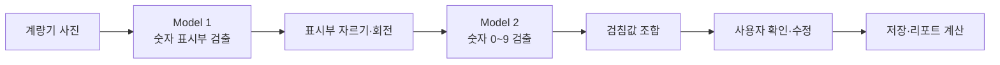

<p align="center">
  
</p>

<h1 align="center">방울이</h1>

<p align="center">
  YOLOX-s 2단계 모델로 수도 계량기 사진을 읽고 사용량·요금·환경 영향을 알려주는 앱
</p>

<p align="center">
  
  
  
  
</p>

## YOLOX-s 2단계 자동 검침

방울이의 핵심은 수도 계량기 사진에서 숫자 표시부를 찾고 검침값을 자동으로 읽는 YOLOX-s 기반 파이프라인이다. 프론트엔드는 촬영 이미지를 FastAPI로 보내며, 서버가 두 개의 YOLOX-s 모델을 순서대로 실행한다.



### 모델 실험과 선택

| 모델 | 진행 결과 | 선택 판단 |
|---|---|---|
| YOLOv8s | 검토 후 제외 | AGPL-3.0 라이선스를 고려해 학습 전에 제외 |
| YOLOX-Tiny | 학습 시도 후 실패 | 성공한 가중치와 평가 결과를 확보하지 못함 |
| YOLOv9s | 학습 시도 후 실패 | 학습 실패로 비교 후보에서 제외 |
| RF-DETR-nano | 비교 평가 | 검출 성능은 유사했지만 추론 시간 미측정 |
| **YOLOX-s** | **최종 선정·현재 적용** | 추론 시간을 실측했고 ONNX 변환과 FastAPI 연동이 용이 |

현재 Model 1은 계량기의 숫자 표시부를 검출하고, Model 2는 잘라낸 표시부에서 숫자 0~9를 검출한다. 모델별 실험 수치, 선정 근거, 회전 보정과 후처리 방식은 [YOLOX 모델 선정과 검침 파이프라인](docs/yolox-model-pipeline.md)에 정리돼 있다.

## 주요 기능

- 계량기 사진 촬영과 YOLOX 기반 검침값 인식.
- 인식 실패 시 수동 입력과 계량기 교체 기준점 처리.
- 지역별 수도 요금, 사용량과 환경 영향 계산.
- 주간·월간·연간 리포트와 검침·교체 이력 조회.
- 매일 검침 알림, 글자 크기와 현재 기기 데이터 초기화 설정.
- 나무코인으로 방울이 옷과 방을 꾸미는 리워드 UI.

## 기술 구성

| 영역 | 구성 | 역할 |
|---|---|---|
| Backend | Python 3.12, FastAPI, SQLModel, SQLite | 검침, 이력, 지역 설정과 요금 계산 API |
| Model 1 | YOLOX-s, ONNX Runtime | 수도 계량기 숫자 표시부 검출 |
| Model 2 | YOLOX-s, ONNX Runtime | 표시부 내부 숫자 0~9 검출 |
| Frontend | React 19, Vite 8 | 모바일 중심 웹 UI와 API 연동 |
| Mobile | Capacitor 8, Android | 카메라와 로컬 알림을 사용하는 앱 컨테이너 |
| Operation | Docker, AWS EC2 | 운영 API 실행과 데이터·가중치 영속화 |

## 빠른 시작

### 백엔드

```powershell
uv sync
uv run uvicorn src.api.main:app --reload --host 0.0.0.0 --port 8000
```

Swagger UI는 `http://localhost:8000/docs`에서 확인한다.

### 프론트엔드

Node.js 22 이상을 사용한다.

```powershell
cd frontend
npm install
npm run dev
```

Vite 개발 서버는 기본적으로 `http://localhost:5173`에서 실행된다. 자세한 환경변수, 테스트와 Android 빌드 방법은 [프론트엔드 안내](frontend/README.md)를 참고한다.

## 저장소 구조

```text
src/                    FastAPI, YOLOX 추론, 17개 지역 요금 계산
tests/                  Python API·도메인 테스트
frontend/               React UI, Node 테스트, Capacitor Android
data/                   로컬 SQLite 데이터, Git 제외
weights/                표시부·숫자 YOLOX-s ONNX 가중치
docs/                   프론트 인수인계, API와 EC2 배포 문서
output/                 팀 확인용 빌드 산출물 안내
```

`data/data.db`에는 로컬 실행 중 생성한 검침 이력과 지역 설정이 저장된다. 이 폴더는 Git에 포함되지 않으며 EC2 운영 서버의 데이터와 별개다. 삭제하면 다음 실행 때 빈 DB가 다시 생성되지만 기존 로컬 이력은 사라진다.

## 테스트

```powershell
# 저장소 루트
uv run pytest

# frontend
cd frontend
node --test
npm run build
```

## 모바일 앱

Android 앱 ID는 `com.jjang.banguli`다. 현재 Debug APK는 에뮬레이터 기본 흐름까지 검증됐으며 실제 기기의 카메라·알림 E2E는 남아 있다.

- [프론트엔드와 Capacitor 개발 안내](frontend/README.md).
- [빌드 산출물 안내](output/README.md).
- [Android 테스트 APK 상세](output/android/README.md).

iOS는 현재 빌드 산출물이 없다. 기존 React UI를 재사용할 수 있지만 Mac, Xcode, HTTPS API와 iPhone 실기기 검증이 필요하다.

## 문서

- [YOLOX 모델 선정과 검침 파이프라인](docs/yolox-model-pipeline.md).
- [프론트엔드 연동 인수인계](docs/frontend-integration-handoff.md).
- [프론트엔드 연동 인수인계 PDF](docs/banguli-frontend-integration.pdf).
- [API 사용 가이드](docs/api-guide.md).
- [EC2 Docker 배포 가이드](docs/deployment-guide.md).

운영 API는 EC2 Docker에서 `http://13.53.120.64:8000`으로 실행된다. 배포·업데이트·로그·복구 절차는 EC2 배포 가이드를 따른다.

## 팀원

<table>
  <tr>
    <td align="center" width="160">
      <a href="https://github.com/jaeheonki">
        <br>
        <sub><b>김재헌 (PM)</b></sub>
      </a>
    </td>
    <td align="center" width="160"><br><sub><b>정승호</b></sub></td>
    <td align="center" width="160"><br><sub><b>노승원</b></sub></td>
    <td align="center" width="160"><br><sub><b>유수빈</b></sub></td>
  </tr>
</table>
