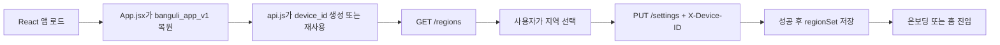
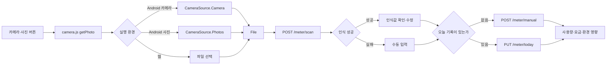
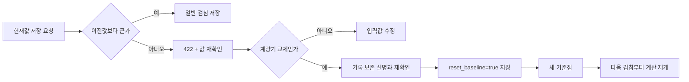
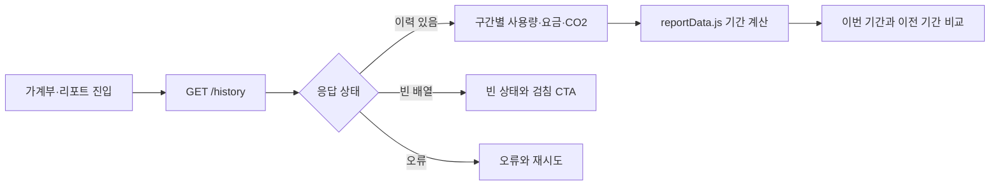
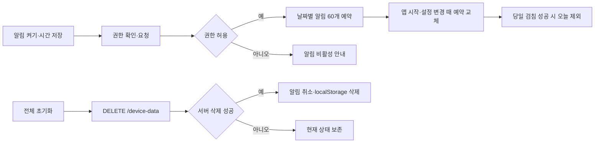
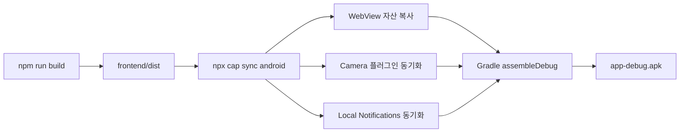
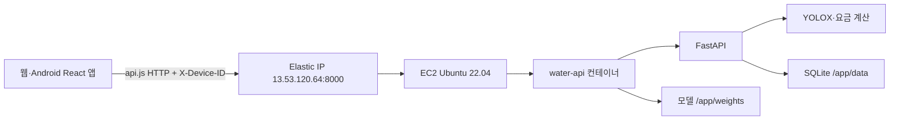

# 방울이 프론트엔드 연동 인수인계

작성일 2026-07-17<br>
대상 브랜치 `feature_app_merge`<br>
Android appId `com.jjang.banguli`

## 1. 문서 목적과 현재 상태

방울이는 수도 계량기 사진에서 검침값을 읽고, 이전 검침과의 차이로 사용량·요금·환경 영향을 보여주는 React 앱이다. 이 문서는 복구된 UI가 FastAPI, 모델 추론, 로컬 알림, Capacitor Android와 AWS 운영 API에 연결되는 순서를 팀원이 빠르게 이해하도록 정리한다.

프론트 연결과 운영 접점을 중심으로 설명한다. 요금 계산 공식과 YOLOX 내부 구현은 각각 `src/calculation/`, `src/model/`을 참고한다. API의 필드별 계약은 [API 가이드](api-guide.md), EC2 명령의 기준은 [배포 가이드](deployment-guide.md)를 따른다.

현재 완료된 범위는 웹 전체 흐름, 운영 API 연결, Debug APK 빌드와 Android 에뮬레이터·Galaxy 실기기의 핵심 E2E다. 실기기에서는 카메라 촬영, 인식값 확인·수정, 저장, 물 가계부와 에너지 리포트 반영까지 확인했다. 로컬 알림 수신과 탭 이동은 아직 실기기에서 검증하지 않았다.

## 2. 저장소 구조

```text
smart_water_meter/
├─ src/                         # FastAPI, 계산 모듈, YOLOX 추론
├─ tests/                       # Python API·도메인 회귀 테스트
├─ frontend/
│  ├─ public/img/               # 방울이, 의상, 방 테마, 소품 PNG 103개
│  ├─ src/                      # React 화면과 연동 어댑터
│  ├─ tests/                    # Node 계약·통합 테스트
│  ├─ android/                  # Capacitor Android 프로젝트
│  ├─ capacitor.config.json
│  └─ package.json
├─ docs/
│  ├─ banguli-final-report.pdf   # 프로젝트 최종 보고서
│  ├─ yolox-model-pipeline.md
│  ├─ frontend-integration-handoff.md
│  ├─ api-guide.md
│  └─ deployment-guide.md
├─ output/
│  └─ android/
│     ├─ README.md
│     └─ banguli-debug.apk      # 로컬 전달용, Git 제외
├─ Dockerfile
├─ pyproject.toml
├─ uv.lock
└─ README.md
```

`src/`와 `tests/`를 `backend/` 아래로 옮기지 않았다. 머지 직전에 Python import, Docker 빌드 컨텍스트와 배포 명령을 바꾸지 않고, 실행과 무관한 중복·임시 파일만 걷어내기 위한 결정이다.

## 3. UI 복구와 화면 구성

초기 프론트는 공유 HTML 번들 안에 이스케이프된 JSX로만 존재했다. 원본 JSX를 복구해 Vite React 프로젝트로 옮기고, 412×892 데모 휴대전화 프레임과 아티팩트 편집 패널을 제거했다. 앱 화면은 실제 모바일 WebView가 크기를 담당한다.

공유 HTML에는 이미지 파일이 들어 있지 않았다. 별도로 전달받은 PNG 103개를 `frontend/public/img/`에 복구해 방울이 표정, 의상, 방 테마와 꾸미기 소품을 원래 파일명으로 연결했다. Google Material Symbols도 복원해 가계부·리포트·설정 아이콘이 빈 원으로 보이던 문제를 해결했다.

| 화면 | 파일 | 주요 책임 |
|---|---|---|
| 온보딩 | `frontend/src/components/Onboarding.jsx` | 앱 소개, 가구원 수와 목표량 선택 |
| 홈 | `frontend/src/components/HomeScreen.jsx` | 방울이 상태, 코인, 옷장·방 꾸미기, 설정 진입 |
| 사진 검침 | `frontend/src/components/CameraFlow.jsx` | 촬영, 인식값 확인, 수동 입력, 교체 기준점, 결과 표시 |
| 물 가계부 | `frontend/src/components/LedgerScreen.jsx` | 서버 검침 이력의 최신순 목록과 빈 상태 |
| 에너지 리포트 | `frontend/src/components/ReportScreen.jsx` | 주간·월간·연간·날짜 지정 집계와 기간 비교 |
| 상점 | `frontend/src/components/ShopScreen.jsx` | 의상, 방 테마, 소품 구매·적용 |
| 설정 | `frontend/src/components/SettingsScreen.jsx` | 알림, 지역, 글자 크기, 교체 이력과 전체 초기화 |
| 공용 UI | `frontend/src/components/ui.jsx` | 버튼, 카드, 헤더, 하단 내비게이션과 모달 |

## 4. 프론트 연결 경계

`frontend/src/App.jsx`가 화면 전환과 앱 상태를 조정한다. 화면 컴포넌트는 외부 기능을 직접 호출하지 않고 전용 어댑터 또는 App 콜백을 사용한다.

| 레이어 | 파일 | 책임 |
|---|---|---|
| 앱 조정 | `App.jsx` | 화면 전환, localStorage 저장, 지역 선택, 검침 완료, 알림 갱신, 초기화 |
| API 경계 | `api.js` | 운영·개발 API 주소, `X-Device-ID`, JSON·204 처리와 `ApiError` 통일 |
| 사진 경계 | `camera.js` | Android Camera 플러그인과 브라우저 파일 선택을 `Promise<File>`로 통일 |
| 알림 경계 | `notifications.js` | 권한, 60일 예약, 소유 알림 교체·취소, 탭 시 카메라 이동 |
| 지역 표시 | `regions.js` | 한글 지역명과 백엔드 영문 지역 코드의 명시적 매핑 |
| 리포트 집계 | `reportData.js` | 기간 범위, 비교 기간과 이력 합계를 계산하는 순수 함수 |

### 4.1 localStorage와 서버 데이터의 구분

| 저장 위치 | 데이터 |
|---|---|
| `banguli_app_v1` | 온보딩, 가구원 수, 코인, 의상·방 상태, 글자 크기, 알림 설정, 마지막 검침일 |
| `device_id` | 최초 실행 때 만든 UUID. 모든 기기별 API 요청의 `X-Device-ID` 값 |
| 서버 SQLite | 지역 설정, 검침값, 입력 방식, 신뢰도, 교체 기준점 |

신규 설치 코인은 0에서 시작한다. 전체 앱 초기화는 서버 데이터 삭제가 성공한 뒤에만 알림과 두 localStorage 키를 삭제한다. 서버 삭제가 실패하면 로컬 상태를 보존해 재시도할 수 있게 한다.

## 5. 주요 기능 흐름

### 5.1 최초 실행과 지역 설정



1. Vite 브라우저 또는 Capacitor WebView가 React 번들을 실행한다.
2. `App.jsx`가 기본 상태와 `banguli_app_v1`을 병합한다.
3. 지역 미설정이면 `RegionModal`이 `GET /regions` 결과를 한글 이름으로 표시한다.
4. 사용자가 선택하면 `saveSettings(code)`가 서버에 영문 지역 코드를 저장한다.
5. 성공한 뒤에만 모달을 닫고 `region`, `regionSet`을 localStorage에 남긴다. 실패하면 선택과 오류를 유지해 같은 값을 다시 보낼 수 있다.

### 5.2 사진 검침과 저장



1. `CameraFlow`가 촬영은 `getPhoto('camera')`, 사진 선택은 `getPhoto('photos')`로 호출한다.
2. Android는 각 입력을 `CameraSource.Camera`와 `CameraSource.Photos`로 구분하고 URI를 Blob과 File로 바꾼다. 웹은 파일 선택 결과를 그대로 File로 반환한다.
3. `scanMeter(file)`가 `image` 필드의 multipart 요청을 보낸다. `/meter/scan`은 인식만 수행하며 저장하지 않는다.
4. 성공하면 검출값과 신뢰도를 보여주고 사용자가 값을 수정·확정할 수 있다. `success: false`면 오류 페이지 대신 수동 입력으로 이동한다.
5. 앱 시작 시 `GET /meter/today`로 오늘 기록을 확인한다. 오늘 첫 확정은 `saveReading()`의 `POST /meter/manual`, 재확정은 `updateTodayReading()`의 `PUT /meter/today`로 같은 행을 수정한다.
6. 첫 검침은 기준값으로만 저장된다. 두 번째부터 서버 응답의 사용량, 요금과 환경 영향을 결과 화면에 표시한다.
7. 저장 성공 시 `recorded_at`을 로컬 날짜로 바꿔 `lastReadingDate`에 저장하고 오늘 알림이 예약되지 않도록 갱신한다.
8. 오늘 기록이 있으면 홈에 `오늘 기록 수정` 버튼을 표시하며 사진 재인식과 직접 입력을 모두 허용한다. 수정은 코인과 연속 기록을 중복으로 늘리지 않는다.

파일 선택과 카메라 취소는 서버 오류로 표시하지 않고 촬영 화면으로 돌아간다. 사진 준비 오류와 네트워크·서버 오류는 서로 다른 안내를 표시한다.

### 5.3 감소 검침과 계량기 교체



1. 일반 저장에서 현재값이 이전값보다 작거나 같으면 서버는 DB에 쓰지 않고 422를 반환한다.
2. UI는 값 확인과 계량기 교체 가능성을 분리해 안내한다.
3. 사용자가 교체를 명시적으로 두 번 확인하면 같은 제출값을 `reset_baseline: true`로 다시 보낸다.
4. 기존 이력은 삭제하지 않고 새 값을 기준점으로 남긴다.
5. 이력 계산은 교체 직전 감소 구간을 제외하고, 기준점과 다음 검침 사이부터 재개한다.
6. 설정의 교체 이력 화면은 `GET /history/replacements`를 최신순으로 표시한다.

### 5.4 이력과 에너지 리포트



- 물 가계부는 서버가 반환한 최신순 구간을 표시한다.
- 리포트는 주간 7일, 월간 30일, 연간 365일과 날짜 지정 범위를 지원한다.
- 날짜 지정은 `GET /history/period?start=YYYY-MM-DD&end=YYYY-MM-DD`로 현재 기간과 바로 이전의 같은 길이 기간을 각각 조회한다.
- 집계는 선택 기간 안에 완전히 포함된 구간만 합산한다.
- 모든 리포트 상태에서 이번 기간을 표시하고, 비교 카드에는 이전 기간과 이번 기간의 날짜를 함께 표시한다.

### 5.5 알림·설정·전체 초기화



- 알림 기본 시각은 20:00이며 기본 상태는 꺼짐이다.
- 알림 문구는 `방울이가 마를 것 같아요!`, `오늘의 수도 계량기를 검침해 주세요.`다.
- 서버나 계정 없이 Android 로컬 알림 60개를 예약한다. 앱을 60일 넘게 열지 않으면 다음 실행 전까지 추가 알림이 예약되지 않는 제약을 수용했다.
- 앱 시작, 설정 변경과 검침 성공 시 기존에 이 앱이 소유한 예약만 안전하게 교체한다.
- 알림을 누르면 사진 검침 화면으로 이동한다. 웹에서는 플러그인을 호출하지 않는 성공 no-op으로 동작한다.
- 전체 초기화는 이중 확인 후 현재 `device_id`의 Reading과 Settings만 삭제한다.

## 6. Capacitor Android 연결

`frontend/capacitor.config.json`의 핵심 설정은 다음과 같다.

```json
{
  "appId": "com.jjang.banguli",
  "appName": "방울이",
  "webDir": "dist",
  "server": {
    "androidScheme": "http",
    "cleartext": true
  }
}
```



Capacitor Camera 8은 갤러리에 저장하지 않으면 별도 Android CAMERA manifest 권한을 요구하지 않는다. 현재 앱은 `saveToGallery`를 사용하지 않는다. 운영 API가 HTTP이므로 cleartext 통신을 허용했다. 스토어 배포 전에는 도메인과 HTTPS로 전환하고 이 예외를 축소하는 것이 권장된다.

## 7. AWS Docker 운영 연결

프론트나 APK를 EC2 Docker에 넣지 않는다. Docker는 FastAPI, YOLOX와 SQLite 백엔드만 실행한다.



| 구성 | 값과 역할 |
|---|---|
| 운영 API | `http://13.53.120.64:8000` |
| Docker 이미지 | `water-meter-api` |
| 컨테이너 | `water-api` |
| 포트 | EC2 8000 → 컨테이너 8000 |
| 재시작 정책 | `unless-stopped` |
| 모델 볼륨 | `~/smart-water-meter-kr/weights:/app/weights` |
| DB 볼륨 | `~/smart-water-meter-kr/data:/app/data` |

이미지와 컨테이너를 교체해도 모델 가중치와 SQLite 데이터는 EC2 호스트에 남는다. 내부 `localhost:8000/health`와 외부 Elastic IP의 `/health`를 모두 확인한다. EC2 재부팅 뒤에도 `unless-stopped` 정책으로 약 2분 안에 자동 복구되는 것을 실측했다.

운영 업데이트 명령과 주의사항은 [배포 가이드](deployment-guide.md)에 유지한다.

## 8. 실행과 빌드

### 8.1 백엔드 로컬 실행

```powershell
uv sync
uv run uvicorn src.api.main:app --reload --host 0.0.0.0 --port 8000
```

Swagger UI는 `http://localhost:8000/docs`다.

### 8.2 프론트 로컬 실행

```powershell
cd frontend
npm install
npm run dev
```

프론트는 `http://localhost:5173`에서 실행되고 `frontend/.env.development`의 API 주소를 사용한다.

### 8.3 Android Debug APK 빌드

Android Studio 2025.2.1 이상, 내장 JDK 21과 Android SDK 36을 사용한다.

```powershell
cd frontend
npm install
npm run build
npx cap sync android

$env:JAVA_HOME = "C:\Program Files\Android\Android Studio\jbr"
$env:ANDROID_HOME = "$env:LOCALAPPDATA\Android\Sdk"
$env:ANDROID_SDK_ROOT = $env:ANDROID_HOME

cd android
.\gradlew.bat assembleDebug
```

Gradle 원본 APK는 `frontend/android/app/build/outputs/apk/debug/app-debug.apk`, 팀 확인용 복사본은 `output/android/banguli-debug.apk`다. 설치·해시·검증 상태는 `output/android/README.md`를 참고한다.

## 9. 검증 명령과 결과

```powershell
# 저장소 루트
uv run pytest

# frontend
node --test
npm run build
npx cap sync android

# frontend/android
.\gradlew.bat assembleDebug
```

2026-07-17 정리 시작 전 기준선은 pytest 42건과 Node 테스트 59건이 모두 통과했다. Vite 빌드, Capacitor 동기화와 Gradle Debug 빌드도 통과한 상태에서 정리를 시작했다. 최종 산출물 생성 뒤 다시 실행한 결과는 pytest 56건, Node 테스트 89건 통과다.

에뮬레이터에서 앱 데이터 초기화 후 다음을 확인했다.

- 신규 설치 코인 0.
- 온보딩과 지역 선택 표시.
- 서울 선택을 운영 API에 저장하고 홈으로 진입.
- localStorage의 `onboarded`, `region`, `regionSet`, `device_id` 유지.
- Capacitor가 HTTP `localhost`에서 WebView 자산을 로드하고 Camera·Local Notifications 플러그인을 등록.

## 10. 남은 검증

Galaxy 실기기에서 시스템 카메라 열기와 계량기 촬영, 모델 인식 결과 확인과 수동 입력 폴백, 하루 한 번 신규 저장과 당일 기록 수정, 물 가계부·에너지 리포트 반영, 앱 완전 종료 후 재실행 시 같은 기기 데이터로 홈 복귀까지 확인했다. 항목별 결과는 `output/android/README.md`와 최종 보고서에 정리돼 있다.

다음 항목은 아직 확인하지 않았다.

- 실기기에서 알림 권한 허용·거부, 지정 시각 수신과 탭 후 검침 화면 이동.
- 실제 iPhone 사진의 HEIC 업로드 호환성 확인.
- HTTPS 운영 API 전환 후 Android 네트워크 보안 설정 재검증.

## 11. 정리 결정

완료된 날짜별 설계·계획, 작업 로그, 복구 원본 사본과 일회성 추출 스크립트는 이 문서로 중요한 내용을 옮긴 뒤 활성 트리에서 제거한다. 삭제된 세부 내용은 Git 이력으로 확인할 수 있다.

`.venv`, `frontend/node_modules`, `weights`, 실제 `data/`, `.claude`, `.superpowers`는 로컬 실행이나 도구 상태이므로 디스크에서는 유지하고 Git에서만 제외한다. APK 바이너리도 Git에 커밋하지 않으며, 실기기 검증 후 공유할 때는 GitHub Release 첨부 파일을 사용한다.
