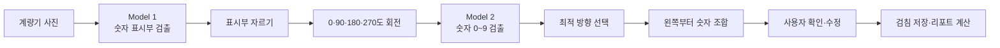

# YOLOX 모델 선정과 수도 계량기 검침 파이프라인

## 문서 목적

방울이의 핵심은 수도 계량기 사진을 YOLOX로 분석해 검침값을 자동으로 읽는 기능이다. 이 문서는 모델을 선택한 과정과 현재 저장소에서 동작하는 2단계 추론 구조를 팀원이 빠르게 이해할 수 있도록 정리한다.

내용은 팀 진행보고서인 `방울이 프로젝트 진행 보고서`, 현재 `src/model/` 구현, 저장소의 ONNX 내보내기 이력을 근거로 한다. 진행보고서에 없는 학습 세부 조건이나 성능 수치는 추정하지 않는다.

## 핵심 검침 흐름



프론트엔드와 Android 앱은 모델을 직접 실행하지 않는다. 촬영한 이미지를 FastAPI의 `POST /meter/scan`으로 보내고, 서버가 YOLOX 추론 결과를 반환한다. 사용자가 결과를 확인하거나 수정한 뒤 `POST /meter/manual`로 확정값을 저장한다.

## 데이터 준비

- 팀원들이 수도 계량기 사진 약 200장을 직접 촬영했다.
- 진행보고서에는 숫자 표시 영역을 바운딩 박스로 라벨링한 것으로 기록돼 있다.
- 숫자별 학습 데이터의 수량과 분할 방식은 현재 저장소와 진행보고서에 남아 있지 않으므로 별도 수치로 단정하지 않는다.

## 검토한 모델

| 모델 | 진행 결과 | 판단 근거 |
|---|---|---|
| YOLOv8s | 검토 후 제외 | AGPL-3.0 라이선스가 프로젝트 배포 조건과 맞지 않아 학습 전에 제외했다. |
| YOLOX-Tiny | 학습 시도 후 실패 | 학습을 시도했으나 성공한 가중치와 평가 결과를 확보하지 못했다. |
| YOLOv9s | 학습 시도 후 실패 | 학습 실패로 비교 후보에서 제외했다. |
| RF-DETR-nano | 비교 평가 | 검출 성능은 YOLOX-s와 유사했지만 추론 시간을 측정하지 못했다. |
| YOLOX-s | 최종 선정·현재 적용 | 추론 시간을 실측했고 ONNX 내보내기와 FastAPI 연동이 쉬워 최종 선택했다. |

### 진행보고서의 비교 결과

| 지표 | YOLOX-s | RF-DETR-nano |
|---|---:|---:|
| mAP@0.50 | 1.000 | 1.000 |
| mAP@0.50-95 | 0.729 | 0.743 |
| 추론 시간 | 108.44ms | 미측정 |

YOLOX-s 추론 시간은 forward 96.44ms와 NMS 12.01ms의 합으로 기록돼 있다. 이 표는 모델 선정 당시 진행보고서에 남은 검출 실험 결과이며, 현재 2단계 전체 파이프라인의 종단 간 성능을 뜻하지 않는다. 평가 데이터 분할과 실행 환경의 상세 정보도 저장소에 남아 있지 않으므로 외부 벤치마크와 직접 비교하는 수치로 사용하지 않는다.

## YOLOX-s를 선택한 이유

- YOLOX-s와 RF-DETR-nano의 mAP 차이가 작았다.
- YOLOX-s는 추론 시간을 직접 측정했다.
- ONNX로 내보낸 뒤 PyTorch 없이 ONNX Runtime으로 실행할 수 있었다.
- `Exp` 클래스 기반으로 입력 크기와 하이퍼파라미터를 조정하기 쉬웠다.
- 이미지당 계량기 표시부 하나를 찾는 top-1 검출 구조에 적합했다.
- CUDA가 있으면 GPU를 사용하고, 없으면 CPU로 실행할 수 있다.

## 현재 구현된 2단계 모델

### Model 1. 계량기 숫자 표시부 검출

- 구현 파일은 `src/model/detector.py`다.
- 가중치는 `weights/meter_yolox_s.onnx`와 외부 데이터 파일인 `weights/meter_yolox_s.onnx.data`를 사용한다.
- 원본 이미지를 640×640으로 레터박스 전처리한다.
- confidence 0.3과 NMS IoU 0.45를 기본값으로 사용한다.
- NMS 이후 신뢰도가 가장 높은 표시부 하나만 반환한다.

### Model 2. 개별 숫자 검출

- 구현 파일은 `src/model/digit_detector.py`다.
- 가중치는 `weights/digit_yolox_s.onnx`와 `weights/digit_yolox_s.onnx.data`를 사용한다.
- 표시부 이미지에서 숫자 `0`부터 `9`까지 10개 클래스를 검출한다.
- 각 결과는 숫자의 바운딩 박스, 클래스 값과 신뢰도로 구성된다.

### 후처리와 검침값 조합

`src/model/pipeline.py`가 두 모델을 연결한다.

1. Model 1이 찾은 표시부에 8픽셀 여백을 더해 이미지를 자른다.
2. 잘라낸 이미지를 0도, 90도, 180도와 270도로 회전해 Model 2를 실행한다.
3. 평균 신뢰도, 숫자의 한 줄 정렬 정도와 검출 개수로 각 방향의 점수를 계산한다.
4. 점수가 가장 높은 방향의 숫자를 x좌표 기준으로 정렬한다.
5. 숫자를 문자열로 조합하고 평균 신뢰도와 함께 반환한다.
6. `/meter/scan`은 문자열의 마지막 세 자리를 리터 단위로 보고 1000으로 나눠 `m³` 값으로 반환한다.

HEIC를 포함한 입력 이미지는 EXIF 방향을 먼저 보정한다. 모델 가중치는 최초 요청 시 `weights/`에 없으면 Google Drive에서 내려받고, 이후 ONNX Runtime 세션을 재사용한다.

## 서버와 앱의 책임 분리

| 구성 요소 | 책임 |
|---|---|
| React·Capacitor 앱 | 사진 촬영, 업로드, 인식 결과 확인·수정, 확정값 표시 |
| FastAPI | 임시 파일 관리, 모델 파이프라인 호출, 단위 변환, 검침 API 제공 |
| YOLOX Model 1 | 계량기 숫자 표시부 검출 |
| YOLOX Model 2 | 표시부 내부의 숫자 0~9 검출 |
| 계산·이력 모듈 | 확정된 검침값 저장, 사용량·요금·에너지·CO₂ 계산 |

인식 실패는 빈 결과로 처리하며 앱이 수동 입력 경로를 제공한다. 자동 인식값도 바로 DB에 저장하지 않고 사용자가 확인한 값만 저장하므로, 모델 오인식이 검침 이력에 곧바로 반영되지 않는다.

## 실행과 확인

백엔드를 실행한 뒤 Swagger UI 또는 앱에서 이미지 스캔을 호출한다.

```powershell
uv sync
uv run uvicorn src.api.main:app --reload --host 0.0.0.0 --port 8000
```

```powershell
curl.exe -X POST "http://localhost:8000/meter/scan" -F "image=@C:\path\to\meter.jpg"
```

모델 없이 API 계약만 확인하는 테스트는 파이프라인 결과를 대체해 실행한다.

```powershell
uv run pytest tests/api/test_meter.py
```

실제 모델 성능을 다시 평가하려면 고정된 학습·검증 데이터 분할, 모델별 학습 설정, 실행 장치와 종단 간 추론 시간을 함께 기록해야 한다.
